# WebdriverIO DevTools

A powerful browser devtools extension for debugging, visualizing, and controlling test executions in real-time.

Works with **WebdriverIO**, **[Nightwatch.js](./packages/nightwatch-devtools/README.md)**, **[Selenium WebDriver](./packages/selenium-devtools/README.md)** (any test runner), and **[Python Selenium](./packages/selenium-devtools-py/README.md)** — same backend, same UI, same capture infrastructure.

It runs in two modes: **live** — an interactive dashboard that opens as your tests run — and **trace** — a portable `trace.zip` artifact for offline replay, CI, and AI-agent diffing.

## Quick Start

Install the adapter for your framework, add it to your config, and run — the DevTools dashboard opens automatically.

```bash
npm install @wdio/devtools-service --save-dev   # WebdriverIO (Nightwatch / Selenium below)
```

```js
// wdio.conf.js
export const config = {
  services: ['devtools'] // live mode — opens the dashboard on run
}
```

```bash
npx wdio run wdio.conf.js
```

Want a portable artifact instead of a live UI (CI / agent diffing)? Switch to **trace mode** — see [Configuration](#configuration) and [Usage](#usage). Full setup for each framework: [Installation](#installation) · [Nightwatch](#nightwatch-integration) · [Selenium](#selenium-integration).

## Features

### 🎯 Interactive Test Execution
- **Selective Test Rerun**: Click play buttons on individual test cases, test suites, or Cucumber scenario examples to re-execute them instantly
- **Smart Browser Reuse**: Tests rerun in the same browser window without opening new tabs, improving performance and user experience
- **Stop Test Execution**: Terminate running tests with proper process cleanup using the stop button
- **Test List Preservation**: All tests remain visible in the sidebar during reruns, maintaining full context

### 🎭 Multi-Framework Support
- **Mocha**: Full support with grep-based filtering for test/suite execution
- **Jasmine**: Complete integration with grep-based filtering
- **Cucumber**: Scenario-level and example-specific execution with feature:line targeting

**Dashboard and options by adapter:**

<!-- capability-matrix:readme-dashboard:start -->
<!-- Generated by `pnpm docs:capabilities` in webdriverio/devtools from packages/conformance/src/features.ts. Do not edit by hand. -->

| Feature | WebdriverIO | Selenium | Nightwatch | Python |
|---|---|---|---|---|
| One row per command in the Actions list | ✅ | ✅ | ✅ | ✅ |
| Waits show as one row with what they issued nested under it | ✅ | ✅ | ⚠️ no element-wait polls ¹ | ✅ |
| Screenshot on every command row | ✅ | ✅ | ✅ | ✅ |
| Browser console logs | ✅ | ✅ | ✅ | ✅ |
| Source tab opens the test line that ran the command | ✅ | ✅ | ✅ | ✅ |
| Metadata tab (session, capabilities, device) | ✅ | ✅ | ✅ | ✅ |
| Performance timings on navigation rows | ✅ | ✅ | ✅ | ✅ |
| Failed command in the Errors tab, with the browser's message | ✅ | ✅ | ✅ | ✅ |
| Run, Rerun and Run all from the dashboard | ⚠️ no Cucumber step rerun ² | ⚠️ no Cucumber step rerun ² | ⚠️ no Cucumber step rerun ² | ✅ |
| Preserve & Rerun (compare a failed run with its rerun) | ✅ | ✅ | ✅ | ✅ |
| Dashboard window opens by itself in live mode, and can be turned off | ⚠️ always opens ³ | ✅ `openUi: false` | ⚠️ always opens ⁴ | ✅ `DEVTOOLS_OPEN=0` |
| Turn off per-command screenshots (`captureScreenshots`) | ❌ ⁵ | ✅ | ❌ ⁶ | ❌ ⁶ |
| Force the test browser headless (`headless`) | ❌ ⁷ | ⚠️ Chrome only ⁸ | ❌ ⁷ | ❌ ⁷ |
| Safari kept frontmost so input lands (live mode) | ⚠️ once ⁹ | ✅ before each element input | ⚠️ once ⁹ | ⚠️ once ⁹ |

✅ supported. ⚠️ partial, with the limit in the note below. ❌ not supported. Each supported cell is backed by the cross-adapter conformance suite, a named test or a manual check, listed in [the feature list](https://github.com/webdriverio/devtools/blob/main/packages/conformance/src/features.ts).

¹ A `waitUntil` row holds the commands its condition issued; a `waitForElement*` row has nothing under it, because Nightwatch polls for the element through its own transport rather than `browser`.

² Under Cucumber a Gherkin step has no CLI filter of its own, so the dashboard reruns scenarios and features, not single steps.

³ The service always opens the dashboard in live mode; `devtoolsCapabilities` picks its browser but cannot skip it.

⁴ Nightwatch always opens the dashboard in live mode.

⁵ No option: every command row takes a screenshot, except on Appium, where only native sessions in live mode do.

⁶ No option: every command row takes a screenshot.

⁷ No option: set headless in the browser capabilities, as for any run.

⁸ The option adds `--headless=old` to `goog:chromeOptions` only, so other browsers stay headed; set their own headless capability.

⁹ Brings Safari to the front once after the session starts (live mode, local macOS), so a click issued after another window took the front can still land nowhere.

<!-- capability-matrix:readme-dashboard:end -->

### 📊 Real-Time Visualization
- **Live Browser Preview**: View the application under test in a scaled iframe with automatic screenshot updates
- **Actions Timeline**: Command-by-command execution log with timestamps and parameters
- **Test Hierarchy**: Nested test suite and test case tree view with status indicators
- **Live Status Updates**: Immediate spinner icons and visual feedback when tests start/stop

### 🧐 Debugging Capabilities
- **Command Logging**: Detailed capture of all WebDriver commands with arguments and results
- **Screenshot Capture**: Automatic screenshots after each command for visual debugging
- **Source Code Mapping**: View the exact line of code that triggered each command
- **Console Logs**: Capture and display application console output with timestamps and log levels
- **Network Logs**: Monitor and inspect HTTP requests/responses including headers, payloads, timing, and status codes. Where the driver exposes no BiDi (Safari, Appium), the page's own Resource Timing still lists every request with its timing and size
- **Error Tracking**: Full error messages and stack traces for failed tests

### 🎮 Execution Controls
- **Global Test Running State**: All play buttons automatically disable during test execution to prevent conflicts
- **Immediate Feedback**: Spinner icons update instantly when tests start
- **Actions Tab Auto-Clear**: Execution data automatically clears and refreshes on reruns
- **Metadata Tracking**: Test duration, status, and execution timestamps

### 🎬 Session Screencast
- **Automatic Video Recording**: Captures a continuous `.webm` video of the browser session alongside the existing snapshot and DOM mutation views
- **Per-framework modes**:
  - **WebdriverIO**: CDP push mode for Chrome/Chromium (efficient, no per-command overhead); polling fallback for other browsers
  - **Selenium WebDriver**: CDP push mode via `selenium-webdriver/bidi`; polling fallback otherwise
  - **Nightwatch.js**: Polling mode (Nightwatch doesn't expose a stable CDP escape hatch); works on every browser Nightwatch supports
- **Per-Session Videos**: Each browser session (including sessions created by `browser.reloadSession()`) produces its own recording, selectable from a dropdown in the UI
- **Smart Trimming**: Leading blank frames before the first URL navigation are automatically removed so videos start at the first meaningful page action

> For setup, configuration options, and prerequisites see each adapter's README: **[WebdriverIO](./packages/service/README.md#screencast-recording)** · **[Selenium](./packages/selenium-devtools/README.md)** · **[Nightwatch](./packages/nightwatch-devtools/README.md#screencast)**.

### 🐞 Preserve & Rerun (Compare)
- **When the bug icon appears**: Only on test/suite rows in a `failed` state and the icon sits next to ▶ on hover, available wherever a plain rerun is supported (e.g. Cucumber scenarios at the scenario row, Mocha tests at the test or suite row)
- **Side-by-side diff**: Click the bug-play icon on a failed test to snapshot the failing run and rerun in one action and the Compare tab shows the two runs aligned by command, with the failure point and assertion error (Expected vs Received) called out
- **Diagnose flaky tests**: See exactly which command differed between a pass and a fail without re-reading logs
- **Pop out**: Open the comparison in a separate, themed window for a roomier view

> Available across **WebdriverIO, Selenium WebDriver, and Nightwatch.js**. The rerun mechanism differs per framework (WDIO uses `--spec` + grep, Selenium substitutes a runner-specific filter flag like `--grep`/`--testNamePattern`, Nightwatch reads `DEVTOOLS_RERUN_LABEL`); the dashboard contract is identical.

### 🌐 BiDi capture (browser console + JS exceptions + network)

Real-time capture of browser-side events through the WebDriver BiDi protocol — entries arrive in the dashboard as they happen instead of being scraped after each command.

| Adapter | BiDi source | Default | How to enable |
|---|---|---|---|
| **WebdriverIO** | WDIO's native `browser.on('log.entryAdded' \| 'network.*')` | On | Automatic when the driver advertises BiDi (Chrome ≥114) |
| **Selenium WebDriver** | `selenium-webdriver/bidi/{logInspector, networkInspector}` | On when available | Automatic; `ensureBidiCapability` sets `webSocketUrl=true` on the Builder |
| **Nightwatch.js** | Same `selenium-webdriver/bidi` inspectors (Nightwatch ships selenium-webdriver internally) | Opt-in | `globals: nightwatchDevtools({ bidi: true })` + `desiredCapabilities: { webSocketUrl: true }` |

When BiDi is active in Selenium or Nightwatch, the per-command Chrome performance-log network-capture path is gated off so requests don't appear twice in the dashboard. The attach + sink logic lives in `@wdio/devtools-core`'s `bidi.ts` — same module both adapters consume.

**Without BiDi: Safari, and every session Appium serves.** Neither driver exposes BiDi, so there the Network tab is filled by the page itself, through the same injected collector that records the DOM. It patches `fetch` / `XMLHttpRequest` (method, headers, status and body of each call the page makes) and reads the document's **Resource Timing** buffer: every load the browser made (the document, scripts, styles, images, fonts) with its timing phases and size, plus a status on Chromium. What Resource Timing cannot see are headers and bodies, and on Safari the status; each such row says so in its detail card, and its `trace.network` entry carries `_source: "resource-timing"`. When BiDi is serving the session, meaning it has delivered a network event and not merely accepted a subscription (Appium's BiDi shim accepts one and sends nothing), the Resource Timing rows are dropped at ingest so a request is listed once; Nightwatch's performance log, read after the page is drained, upgrades those rows in place with the headers and status it has. A native app session has no document, so it has no network capture at all. Only a device- or proxy-level capture outside the adapters can see that traffic.

### 📦 Trace mode (trace.zip)

The dashboard runs in one of **two modes**, set per adapter via the shared `mode` option:

- **`live`** (default) — the interactive DevTools UI window described above.
- **`trace`** — a headless capture path that writes a portable trace archive, opened later in the **trace player**.

All three JavaScript adapters (`@wdio/devtools-service`, `@wdio/selenium-devtools`, `@wdio/nightwatch-devtools`) emit the **same normalized trace** through the shared `@wdio/devtools-core` capture library, so one archive format and one player serve every framework.

The Python adapter (`selenium-devtools-py`) writes the same archive through the backend, so the trace **format and the player are identical** across all four, but **capture completeness varies**: WebdriverIO is the most complete, and the others cover the core flow with the gaps the table below names. Each adapter's README lists its specifics.

**Support by adapter:**

<!-- capability-matrix:readme-trace:start -->
<!-- Generated by `pnpm docs:capabilities` in webdriverio/devtools from packages/conformance/src/features.ts. Do not edit by hand. -->

| Feature | WebdriverIO | Selenium | Nightwatch | Python |
|---|---|---|---|---|
| Trace mode + `show-trace` player | ✅ | ✅ | ✅ | ✅ |
| DOM time-travel (mutation capture) | ✅ | ⚠️ with BiDi ¹ | ⚠️ with BiDi ¹ | ✅ |
| Network requests (browser sessions) | ✅ | ⚠️ with BiDi ² | ⚠️ with BiDi ³ | ✅ |
| Screencast (`filmstrip` / video) | ✅ CDP push (Chrome), polling elsewhere | ✅ CDP push (Chromium), polling elsewhere | ⚠️ polling only ⁴ | ✅ CDP push (Chromium), one frame per command elsewhere |
| Per-test granularity (`traceGranularity: 'test'`) | ✅ | ✅ | ⚠️ ⁵ | ✅ |
| Retry-aware retention (`tracePolicy`) | ✅ | ✅ | ⚠️ `retain-on-failure` only ⁶ | ⚠️ `retain-on-failure` only ⁷ |
| Per-test `screenshot` / `video`, attached to Allure | ✅ | ✅ | ⚠️ produce-only ⁸ | ❌ ⁹ |
| Cucumber Feature→Scenario→Step nesting | ⚠️ Scenario→Step ¹⁰ | ✅ | ⚠️ Feature→Scenario ¹¹ | ❌ ¹² |
| Assertion capture (`captureAssertions`) | ✅ | ⚠️ `node:assert` only ¹³ | ⚠️ no `expect` ¹⁴ | ✅ |
| BiDi console / network capture | ✅ auto | ✅ auto | ⚠️ opt-in ¹⁵ | ✅ auto |
| A11y tab + pick-locator overlay (trace player) | ✅ | ✅ | ✅ | ✅ |
| Transcript + Copy-for-LLM (trace player) | ✅ | ✅ | ✅ | ✅ |
| Unpacked trace output (`traceFormat: 'ndjson-directory'`) | ✅ | ✅ | ✅ | ❌ zip only ¹⁶ |
| Artifacts manifest for CI and reporters (`emitArtifactsManifest`) | ✅ | ✅ | ⚠️ opt-in ¹⁷ | ❌ ¹⁸ |
| Network without BiDi (Safari, Appium mobile browsers) | ⚠️ ¹⁹ | ⚠️ ¹⁹ | ⚠️ ¹⁹ | ⚠️ ¹⁹ |

✅ supported. ⚠️ partial, with the limit in the note below. ❌ not supported. Each supported cell is backed by the cross-adapter conformance suite, a named test or a manual check, listed in [the feature list](https://github.com/webdriverio/devtools/blob/main/packages/conformance/src/features.ts).

¹ Without BiDi (Safari, Appium) the page collector is injected after each navigation, so a page the test leaves within tens of milliseconds is never captured.

² Without BiDi a page the test leaves within tens of milliseconds is never drained, so its requests are not listed.

³ Without BiDi (`bidi: true`) or Chrome's performance log (`goog:loggingPrefs`), a page the test leaves within tens of milliseconds is never drained, so its requests are not listed.

⁴ Nightwatch exposes no stable CDP handle, so frames come from a `takeScreenshot` poll every 200 ms.

⁵ Nightwatch fires the global `beforeEach` / `afterEach` once per test module for `describe/it` and exports-object tests, so they collapse to one slice keyed to the first test; Cucumber scenarios get real per-test slices.

⁶ For `describe/it` and exports-object tests, `--retries` reruns a testcase internally without firing the per-test hooks again, so the other policies behave like `retain-on-failure`; Cucumber scenarios record every attempt.

⁷ Nothing the Python adapter sends carries an attempt number, so the retry-aware policies behave like `retain-on-failure`.

⁸ Nightwatch has no live Allure attach API, so per-test screenshots and videos are written to disk and listed in the manifest but not attached.

⁹ The Python adapter has no `screenshot` / `video` options and no Allure attachment yet.

¹⁰ The service records no feature ancestry for a scenario, so the trace nests Scenario→Step.

¹¹ Nightwatch steps are not stamped as nested groups, so the trace nests Feature→Scenario.

¹² The Python adapter stamps no Feature or Step groups, so a pytest-bdd scenario is one flat test group with no Feature parent and no Step children.

¹³ `node:assert` rows pass and fail; jest-style `expect()` and chai produce no rows at all, and a failing matcher only marks its test failed.

¹⁴ `assert.*`, `verify.*` and `node:assert` rows pass and fail; Nightwatch's `expect` API produces no rows.

¹⁵ Nightwatch turns it on with `bidi: true` plus `webSocketUrl: true` in the capabilities.

¹⁶ The Python adapter has no option for it and sends no format in its export request, so the backend writes a zip.

¹⁷ Nightwatch has no live Allure signal to turn the manifest on by itself, so it stays opt-in.

¹⁸ The Python adapter writes no artifacts manifest.

¹⁹ Fetch and XHR calls carry headers and bodies; every other load comes from the page's Resource Timing buffer, with timing and size but no headers or body, and no status on Safari.

<!-- capability-matrix:readme-trace:end -->

In trace mode no DevTools UI window opens. At session end the adapter writes trace artifacts into a `test-results/` folder (created next to the resolved spec/config directory), suitable for offline replay, AI-agent diffing, or any consumer that prefers a portable artifact over a live UI.

| Adapter | How to enable |
|---|---|
| **WebdriverIO** | `services: [['devtools', { mode: 'trace' }]]` |
| **Selenium** | `DevTools.configure({ mode: 'trace' })` (before importing `selenium-webdriver`) |
| **Nightwatch** | `globals: nightwatchDevtools({ mode: 'trace' })` |
| **Python** | `pytest --devtools-trace`, or `devtools.enable(trace=True)` in a plain script |

The trace artifact contains:
- `trace.trace` — NDJSON `context-options` + `before`/`after` action events. When test hooks are available (Mocha's `it()` / Cucumber's `Scenario()`), each test becomes a `Tracing.tracingGroup` span — an open/close `before`/`after` pair with `method: "tracingGroup"` and `params.name` set to the test title. Child actions inside the group carry `parentId` pointing back to the group's `callId`, so timeline viewers render tests as labelled spans wrapping their commands. For viewers that render a DOM snapshot per action, it also carries one `frame-snapshot` event per action: a page holding just that action's screenshot. The image is not stored a second time: its `src` is a placeholder `https://screenshot.wdio-devtools.invalid/` address, which the event's `resourceOverrides` maps to the screenshot's file under `resources/`.
- `trace.network` — HAR-style network entries derived from the existing capture
- `resources/page@<id>-<ts>.png` or `.jpeg`: screenshot per user-facing action, named by its actual image format
- `resources/page@<id>-<ts>-elements.json` — flat interactable element list extracted by the page-injected scripts in `@wdio/devtools-core/element-scripts`
- `resources/page@<id>-<ts>-snapshot.txt` — depth-indented accessibility-tree snapshot (AI-friendly)
- `transcript.md` — human/LLM-readable Markdown transcript of the captured actions, with timing, selectors, and value annotations

What counts as a user-facing action is filtered through the `ACTION_MAP` allow-list in [`packages/shared/src/trace-actions.ts`](packages/shared/src/trace-actions.ts) (`url`, `click`, `setValue`, `sendKeys`, `get`, explicit waits such as `waitUntil`, element reads, page reads such as `getTitle`, `execute`, etc.). Locator resolution (`$`, `$$`, `findElement(s)`), Selenium's `executeScript` polling and the `clearValue` that `setValue` fires internally don't produce trace entries.

**Waits.** A wait the test wrote (WebdriverIO `waitFor*` and `waitUntil`, Nightwatch `waitForElement*` and `waitUntil`, Selenium `driver.wait`, Python `WebDriverWait`) is one row, named after what it waited for: `Element.waitForExist` on its selector for a wait on an element locator, `Element.waitForDisplayed` for a wait on an element's visibility, and `Browser.waitForFunction` for any other condition. The row appears as soon as the wait starts and is updated when it ends, and a wait that times out is a failed row carrying the timeout. The commands the wait's condition issued nest under its row, one row per distinct call rather than one per poll, in the live dashboard and the trace player alike, collapsed unless the wait failed or holds the selected row. A command under a passing wait that failed before the wait passed is a poll the wait retried past, not a failure: it shows neutral with its error in a tooltip and is left out of the Errors tab, the copied failures and the trace's errors. Under a wait that timed out, the same commands keep their errors. What each adapter nests is listed under [Waits](https://webdriver.io/docs/devtools/wdio/trace-mode#waits).

**Assertion targets.** An assertion row names the element it is about, so selecting it boxes that element in the snapshot. A `node:assert` call (or a Python `assert`) takes values rather than elements, so its element comes from where the asserted value was read: `assert.equal(await heading.getText(), 'Secure Area')` names `heading`'s selector, and so does a value from any other element read, WebdriverIO's `getHTML` and `getComputedRole` included. Only a read made earlier in the same test (or Cucumber scenario) counts, and a value read from the page itself, such as the title or the URL, names no element, even when some element's text reads the same. WebdriverIO's `browser.getTitle()` is a `Page.getTitle` row of its own, and `expect(browser).toHaveTitle(...)` folds into that read as one `expect.toHaveTitle` row.

Trace mode and live mode are **mutually exclusive** — `screencast` options are ignored in trace mode (live-mode feature). Live and trace serve different audiences (humans debugging vs. agents diffing), and stacking them only costs perf.

#### Viewing traces

**First-party player — `show-trace`.** Open a `.zip` in the WebdriverIO DevTools UI itself:

```sh
pnpm show-trace path/to/trace.zip     # from this repo
npx show-trace path/to/trace.zip      # in a project that installs an adapter
```

`show-trace` reconstructs the trace and serves the same DevTools UI in a dedicated **player** mode: the action list on the left, the page snapshot in the browser pane, and a bottom timeline with a filmstrip, action/network tracks, a draggable playhead, and playback controls (play/step/speed). Click a **Network** bar to open its request detail; press **`?`** for keyboard shortcuts (`Space` play/pause, `←`/`→` step, `Home`/`End`, `,`/`.` speed).

The player exposes everything captured in the archive:

- **DOM time-travel** — the browser pane replays the page from the captured DOM **mutation stream**, so scrubbing the playhead reconstructs the live DOM at any point, not just a screenshot.
- **A11y tab** — the accessibility tree (roles + accessible names) captured for the selected command; hover a row to outline the element in the snapshot, click to copy its locator. Locators are generated in the recording runner's own dialect. An element identified only by its text is `a*=Logout` under WebdriverIO and `//a[contains(., "Logout")]` under Selenium, where the panel names the strategy that resolves it (`By.xpath()`). **Nightwatch prefers a native CSS locator** (`button[type="submit"]`, `a.button`) — it is the only runner that reads a bare selector string under a default CSS strategy — and falls back to XPath, captioned `useXpath()` / `locateStrategy: 'xpath'`, only when nothing unique exists. Every other branch is portable CSS.
- **Errors tab** — every failing `expect`/assertion and step failure collected in one place, each with a jump-to-source link to the command that threw.
- **Element overlay (pick-locator)** — labelled, click-to-copy boxes drawn over every element the test interacted with, cross-linked to the A11y rows.
- **Transcript tab + Copy-for-LLM** — the run's Markdown transcript with a one-click "copy prompt" that bundles it with any failing-command errors, paste-ready for an LLM.
- **Cucumber Feature → Scenario → Step nesting** — tests render as labelled `tracingGroup` spans wrapping their commands, with Cucumber steps nested under their scenario.
- **Dense filmstrip** — with `filmstrip` enabled, the timeline scrubs a continuous screencast for smooth playback rather than one frame per action.
- **Timeline input markers** — keyboard actions and pointer hits (commands with a captured hit point) get distinct glyphs on the timeline.

The `show-trace` bin is exposed by each JavaScript adapter (`@wdio/devtools-service`, `@wdio/nightwatch-devtools`, `@wdio/selenium-devtools`), so `pnpm show-trace <zip>` / `npx show-trace <zip>` work in any project that installs one — no extra dependency.

**Hosted player: [trace.webdriver.io](https://trace.webdriver.io).** The same player as a web page, for opening a trace without installing anything: drop a `.zip` on the page or pick one. The archive is parsed in the browser tab and never uploaded, which matters because a trace records everything the run showed or typed. Run controls are absent, as in `show-trace`. A replayed page still loads its own stylesheets and images from the site under test, as it does in `show-trace`; from an `https` page the browser blocks the `http` ones, so a trace of an `http` site can render unstyled there and fully in `show-trace`. To try the hosted build locally:

```sh
pnpm player:hosted   # builds it and serves it at http://localhost:4173 under the production headers
```

**Other viewers.** The trace uses a portable NDJSON schema, so the same `.zip` also opens in other compatible standalone trace viewers that read the format, and — because it shares that on-disk format — is what an Allure report's **embedded trace viewer** (Allure ≥ 2.35) reads. See the [backend README](./packages/backend/README.md#trace-serving--show-trace) for the reader details.

#### Options

| Option | Values | Default | Description |
|--------|--------|---------|-------------|
| `mode` | `'live'` \| `'trace'` | `'live'` | `'live'` launches the DevTools UI; `'trace'` writes an offline artifact. |
| `traceFormat` | `'zip'` \| `'ndjson-directory'` | `'zip'` | Output layout. `'zip'` writes a single archive; `'ndjson-directory'` unpacks into `trace-<id>/`. |
| `traceGranularity` | `'session'` \| `'spec'` \| `'test'` | `'session'` | `'session'` writes one trace per worker; `'spec'` one per spec file; `'test'` one per test into its own `<spec>-<title>-<browser>[-retryN]/trace.zip` folder — the smallest, most navigable artifacts, and the best pairing for a retention policy. |
| `tracePolicy` | `'on'` \| `'retain-on-failure'` \| `'retain-on-first-failure'` \| `'on-first-retry'` \| `'on-all-retries'` \| `'retain-on-failure-and-retries'` | `'on'` | Which traces to keep. `'on'` keeps every trace; the rest keep only failing/retried tests — pairs well with `traceGranularity: 'test'`. |
| `captureAssertions` | `boolean` | `true` | Capture assertions as action rows: `node:assert` (all adapters), WebdriverIO `expect(...)` matchers, and Nightwatch `browser.assert`/`verify`. Set `false` to opt out. |
| `filmstrip` | `boolean` | `true` | Record a dense, continuous screencast *into* the trace for smooth scrubbing in the player (not just one frame per action). Dense frames sit alongside the per-action frames; thinned + content-addressed at export. Runs the screencast recorder (CDP push on Chrome, polling elsewhere). |
| `emitArtifactsManifest` | `boolean` | auto | Write `devtools-artifacts-<sessionId>.json` next to the trace — the index reporters/CI read to discover produced artifacts. Off by default; auto-enabled when an Allure reporter is detected (Nightwatch stays opt-in). |

The per-test **`screenshot`** and **`video`** artifact options live on each adapter rather than the shared base, are gated to `traceGranularity: 'test'`, and attach inline to Allure on WebdriverIO and Selenium (Nightwatch writes them produce-only) — see the [WebdriverIO](./packages/service/README.md#allure-integration) and [Selenium](./packages/selenium-devtools/README.md) READMEs for the full per-adapter option tables.

**Allure integration.** When an Allure reporter is present, per-test traces, screenshots, and videos attach to each test's card (`traceGranularity: 'test'`); coarser granularities write the artifacts to disk and list them in the manifest. Details and the report-noise settings are in the [WebdriverIO adapter README](./packages/service/README.md#allure-integration).

WDIO config example:

```js
services: [[DevToolsHookService, {
    mode: 'trace',
    traceFormat: 'zip',
    traceGranularity: 'spec'     // one trace per spec file
}]]
```

> **Requires BiDi.** Trace mode uses a WebDriver BiDi preload script. Both Chrome (≥114) and Firefox (≥130) enable BiDi automatically — no capability flags needed.

#### Measuring capture cost

A trace-mode run is slower than a live one because, for every action, the adapter reads the page through the driver: url, title, accessibility tree, element list and a screenshot, plus the page source on a native app. Set `DEVTOOLS_CAPTURE_TIMING=1` on a trace-mode run to see where that time goes. It only measures; nothing is captured differently, and with it unset nothing is timed or written.

When the trace is written, the run prints a table to stderr and appends the raw records, one line per capture, to `capture-timing-<pid>.ndjson` beside the trace (one file per worker process):

```text
[devtools] capture timing: 4 captures (0 native; action 2, wait-poll 1, matcher-poll 1), busy 1.6 s of 10.0 s wall (15.8%)
ms = issue to settle; the driver serves one request at a time, so svc (settle minus the previous probe's settle) is a probe's own cost and the rest is queueing
probe (ms)  n  total  median   p95   max  svc total  svc median
url         4     16       4     4     4         16           4
screenshot  4   1616     254  1004  1004       1600         250
process     4     24       6     6     6         24           6
capture     4   1640     260  1010  1010       1640         260
raw records: /out/capture-timing-1.ndjson
```

(Illustrative numbers from a unit-test fixture, not a real run.)

- **Columns.** The JS adapters issue every read of a capture at once and the driver serves them in order, so a read's time from issue to settle includes waiting behind the reads before it. `svc` subtracts that wait: it is the read's own cost. `process` is the in-process step that turns the reads into a snapshot (page-source parsing and locator generation on native). `capture` is the whole capture.
- **Busy and wall.** `busy` is the time at least one capture was running, overlapping captures counted once; `wall` is the time since the process started, or since the previous report in the same process.
- **Triggers.** `action` is a capture for a user command, `wait-poll` one for a command a wait issued, `matcher-poll` one taken while a WebdriverIO `expect` matcher was polling, and `final` the WebdriverIO capture of the last action's result. Matcher polls are told apart on WebdriverIO only, and only with `captureAssertions` on; Selenium and Nightwatch matchers expose no hook to tell them by.
- **Python.** It reads one thing at a time, so `svc` equals the read's duration; it records the screenshot and the two page reads, and has no url, title or `process` rows.

To measure each platform from the repo's examples (the desktop examples other than Selenium's drive Chrome only):

```sh
# Desktop Chrome, one per adapter
DEVTOOLS_MODE=trace DEVTOOLS_CAPTURE_TIMING=1 pnpm demo:wdio
DEVTOOLS_MODE=trace DEVTOOLS_CAPTURE_TIMING=1 pnpm demo:selenium
DEVTOOLS_MODE=trace DEVTOOLS_CAPTURE_TIMING=1 pnpm demo:nightwatch
DEVTOOLS_MODE=trace DEVTOOLS_CAPTURE_TIMING=1 pnpm demo:python:pytest

# Desktop Firefox and Safari, through selenium-webdriver's SELENIUM_BROWSER (Safari needs `safaridriver --enable` once)
DEVTOOLS_MODE=trace DEVTOOLS_CAPTURE_TIMING=1 SELENIUM_BROWSER=firefox pnpm --filter @wdio/selenium-devtools example:mocha
DEVTOOLS_MODE=trace DEVTOOLS_CAPTURE_TIMING=1 SELENIUM_BROWSER=safari pnpm --filter @wdio/selenium-devtools example:mocha

# Android native (Clock app) and Android Chrome (prerequisites in examples/MOBILE.md)
DEVTOOLS_CAPTURE_TIMING=1 pnpm demo:wdio:mobile
DEVTOOLS_CAPTURE_TIMING=1 DEVTOOLS_MOBILE=web pnpm demo:wdio:mobile

# iOS native (Settings) and iOS Safari
DEVTOOLS_CAPTURE_TIMING=1 DEVTOOLS_MOBILE_PLATFORM=ios pnpm demo:wdio:mobile
DEVTOOLS_CAPTURE_TIMING=1 DEVTOOLS_MOBILE_PLATFORM=ios DEVTOOLS_MOBILE=web pnpm demo:wdio:mobile
```

The mobile lines work the same with `demo:selenium:mobile`, `demo:nightwatch:mobile` and `demo:python:mobile`, which also run in trace mode by default.

#### 📱 Mobile testing

Appium sessions are captured in both live and trace mode. What gets captured depends on one question — **does this session have a web document right now?** — because every DOM drain, page script and viewport read is a round trip that can only fail without one.

**Three kinds of session, and they behave differently:**

| Session | Has a document | What is captured |
|---|---|---|
| **Mobile browser** (Chrome on Android, Safari on iOS) | always | DOM, console and replay as on desktop; network from the page's own record, since Appium serves no BiDi (see [BiDi capture](#-bidi-capture-browser-console--js-exceptions--network)) |
| **Native app** | never | commands, screenshots and element data from the platform's XML tree; no DOM |
| **Hybrid app** | only while in a webview context | native halves as an app, webview halves as a page |

The discriminator is the **browser name in the capabilities**, not the device: mobile web states one, a native app states none. A device is not required either — a Mac2 or tvOS session has no document and is treated the same way.

A hybrid app is the case capabilities alone cannot answer, because the answer changes mid-run. Appium reports `NATIVE_APP` or a webview context, and anything that is not `NATIVE_APP` counts as a webview — the `WEBVIEW_` prefix is a convention, and a driver naming its webview otherwise would have its DOM capture skipped. Following the context costs no round trip: the switch command carries its destination in its own arguments.

**Per-adapter:**

<!-- capability-matrix:readme-mobile:start -->
<!-- Generated by `pnpm docs:capabilities` in webdriverio/devtools from packages/conformance/src/features.ts. Do not edit by hand. -->

| Feature | WebdriverIO | Selenium | Nightwatch | Python |
|---|---|---|---|---|
| Network without BiDi (Safari, Appium mobile browsers) | ⚠️ ¹ | ⚠️ ¹ | ⚠️ ¹ | ⚠️ ¹ |
| Mobile browser sessions (Chrome on Android, Safari on iOS) | ✅ | ✅ | ✅ | ✅ |
| iOS (XCUITest): native apps and Safari | ✅ | ✅ | ✅ | ✅ |
| Native session detected, page-side capture skipped | ✅ | ✅ | ✅ | ✅ |
| Follows a hybrid app into its webview | ⚠️ string form only ² | ⚠️ ³ | ⚠️ ³ | ⚠️ ³ |
| Native app network through appium-interceptor (`appium:intercept`) | ✅ Android | ✅ Android | ✅ Android | ✅ Android |

✅ supported. ⚠️ partial, with the limit in the note below. ❌ not supported. Each supported cell is backed by the cross-adapter conformance suite, a named test or a manual check, listed in [the feature list](https://github.com/webdriverio/devtools/blob/main/packages/conformance/src/features.ts).

¹ Fetch and XHR calls carry headers and bodies; every other load comes from the page's Resource Timing buffer, with timing and size but no headers or body, and no status on Safari.

² Follows `switchContext('WEBVIEW_...')`; the object form (`{ title }` / `{ url }`) and `switchAppiumContext` leave capture on the native side.

³ Decides from the startup capabilities, so a hybrid app's webview half is captured as if it were still native.

<!-- capability-matrix:readme-mobile:end -->

**In the dashboard**, a phone capture is framed as the device — a full-height device column with the action list and dock beside it — in both live mode and the trace player. The trace's `context-options` records the platform, model and OS version, read back so the player labels frames without guessing.

**What a mobile trace does not contain.** Per-action snapshots are issued from inside the command hook, and Appium serialises a probe behind the command it is observing — so where a session has a document to probe, the per-action snapshot is skipped. In practice that means **a hybrid app's webview actions carry no per-action element data, accessibility tree or settle screenshot**. Native sessions, mobile browsers and every desktop session are unaffected. Command rows and their screenshots, console and the archive itself are always captured; a mobile browser's network comes from the page's Resource Timing and fetch/XHR patch rather than from BiDi, and a native session has no network capture, because the driver exposes none. These absences are by design; they are not a capture failure.

On a native session, element data and the A11y panel come from the platform's XML tree rather than the DOM, so locators read as `android=new UiSelector()…` / `-ios predicate string:…` rather than CSS or XPath over HTML.

A runnable example per adapter lives under [examples/](examples/) — `pnpm demo:wdio:mobile`, `:selenium:mobile`, `:nightwatch:mobile`, `:python:mobile`. Each drives the Clock app that ships with every Android system image, keying a duration on the timer keypad without ever starting a timer, so none needs an `.apk` (iOS drives Settings via `DEVTOOLS_MOBILE_PLATFORM=ios`); `DEVTOOLS_MOBILE=web` drives the device's own browser instead — Chrome on Android, Safari on iOS. [examples/MOBILE.md](examples/MOBILE.md) states the prerequisites and switches in one place. A single-adapter WDIO variant also lives at [examples/wdio/mocha/wdio.native.conf.ts](examples/wdio/mocha/wdio.native.conf.ts) (`pnpm demo:wdio:native`), which reads its Appium endpoint from `APPIUM_HOST` / `APPIUM_PORT` / `APPIUM_DEVICE`. In short, for a local emulator:

1. **Java JDK** — `brew install --cask temurin`
2. **Android SDK** — `brew install --cask android-commandlinetools` then `yes | sdkmanager --licenses && sdkmanager "platform-tools" "emulator" "system-images;android-34;google_apis_playstore;arm64-v8a"`. The brew cask installs sdkmanager under `/opt/homebrew/share/android-commandlinetools/`, and sdkmanager downloads other SDK pieces alongside it — set `ANDROID_HOME` to that path (not `~/Library/Android/sdk/`).
3. **AVD + emulator** — `avdmanager create avd -n devtools-test -k "system-images;android-34;google_apis_playstore;arm64-v8a" -d "pixel_7"`, then `emulator -avd devtools-test &` + `adb wait-for-device`.
4. **Appium + UiAutomator2 driver** — `sudo npm i -g appium && appium driver install uiautomator2`.
5. **Chromedriver pinning** — a webview is driven by Chromedriver, and Appium's autodownload frequently has no build matching the Chrome that ships with the system image, in either direction: too old on an older image, too new on a current one. It surfaces as `No Chromedriver found that can automate Chrome '<version>'` when entering a webview context, which reads as a capture failure and is not one — it is why a mobile browser or hybrid run cannot start. Download the matching Chromedriver and start Appium with `--default-capabilities '{"appium:chromedriverExecutableDir": "<path>"}'` plus `--allow-insecure=uiautomator2:chromedriver_autodownload`. A native-app run needs none of this.
6. **Classic WebDriver protocol** — Appium 3's BiDi shim for UiAutomator2 doesn't implement every BiDi command (e.g. `script.addPreloadScript`). Set `'wdio:enforceWebDriverClassic': true` in the capability block so WDIO doesn't attempt the BiDi handshake.

These are emulator-specific issues; on a physical phone with USB debugging only steps 1, 4, 6 (and the Chromedriver pin if Chrome on the device is old) apply.

### 🔍︎ TestLens
- **Source tab**: Click a test to open its source. Command clicks follow the source line in the background; open the Source tab to see it. Available when the source and its location were captured.
- **Open in editor**: The Source tab links the file and line into VS Code (`vscode://file/...`)
- **Quick Navigation**: Jump between test code and execution results seamlessly

### 🏗️ Architecture
- **Frontend**: Lit web components with reactive state management (`@lit/context`)
- **Backend**: Fastify server with WebSocket streaming for real-time updates
- **Shared core**: The three JavaScript adapters share the same capture/reporting library (`@wdio/devtools-core`) — `SessionCapturerBase`, `TestReporterBase`, `ScreencastRecorderBase`, plus pure helpers for console/network/error/sourcemap/BiDi
- **Process Management**: Tree-kill for proper cleanup of spawned processes

See [ARCHITECTURE.md](./ARCHITECTURE.md) for the full package map and data flow, and [CLAUDE.md](./CLAUDE.md) for the conventions in place across the repo.

## Demo

### ▶️ Test Runner
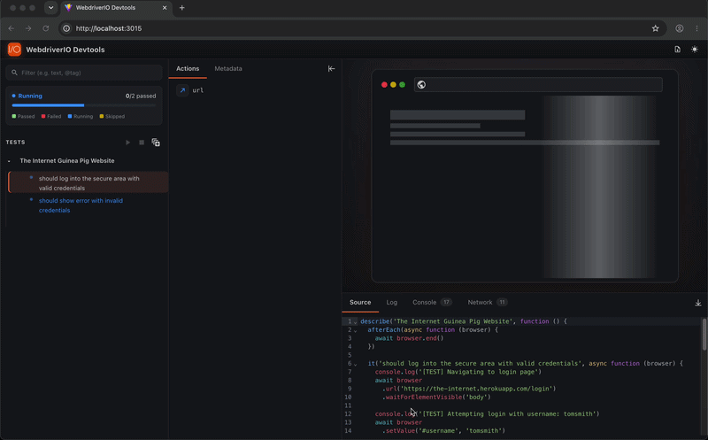

### 🛠️ Test Rerunner & Snapshot
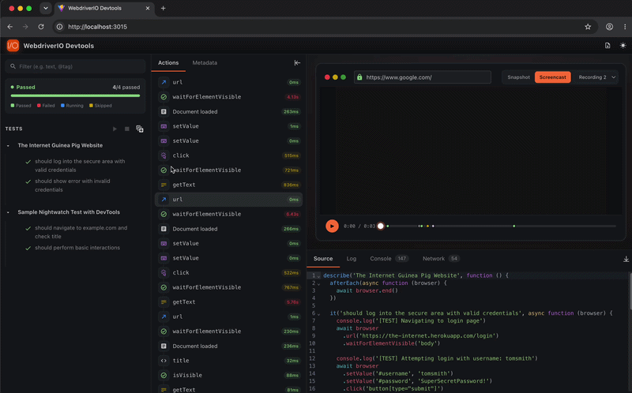

### 🛑 Stop Test Runner
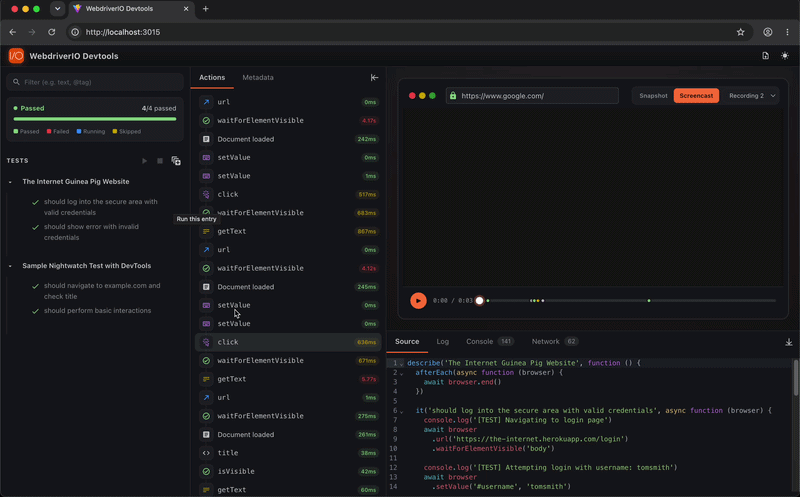

### ⚡ Actions & Command Logs
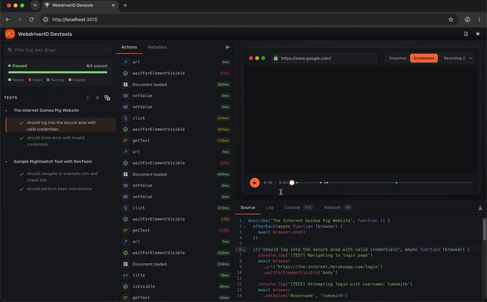

### >_ Console Logs
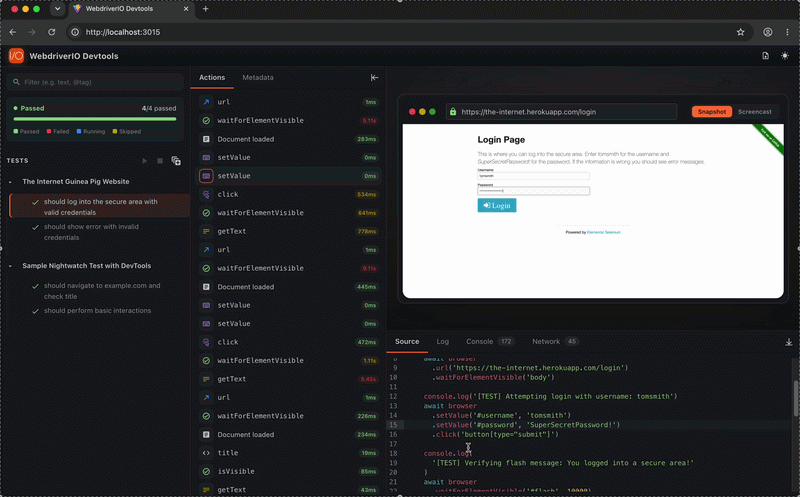

### 🌐 Network Logs
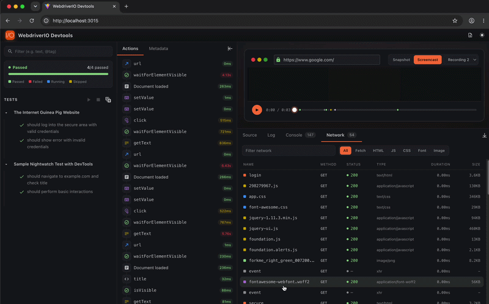

### 📋 Metadata
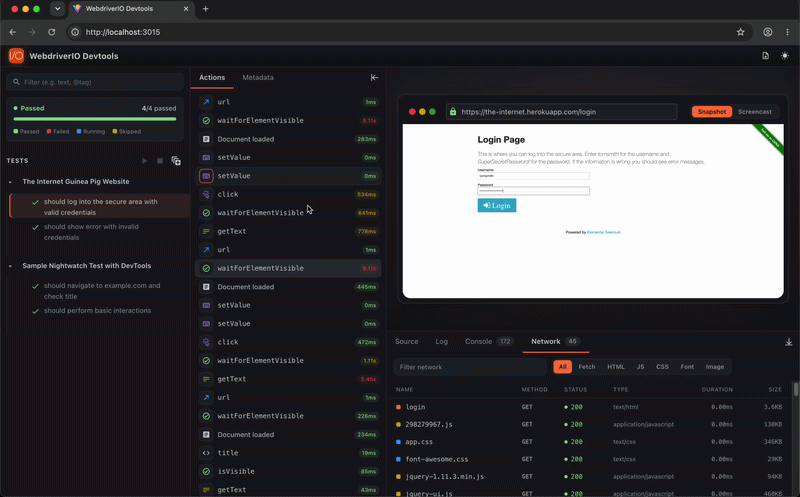

### 🎬 Session Screencast
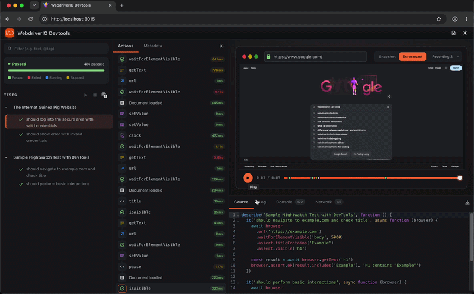

### 🐞 Preserve & Rerun
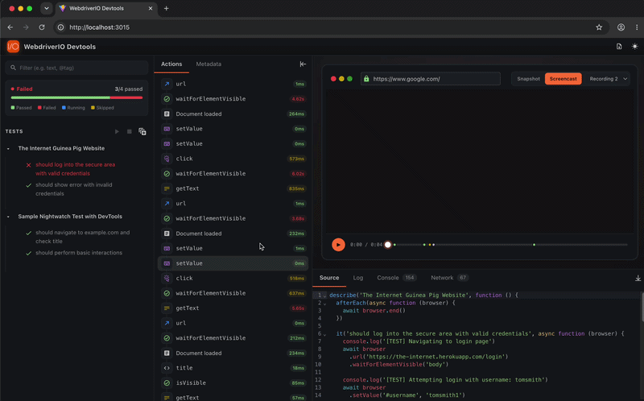

### 🔍︎ TestLens
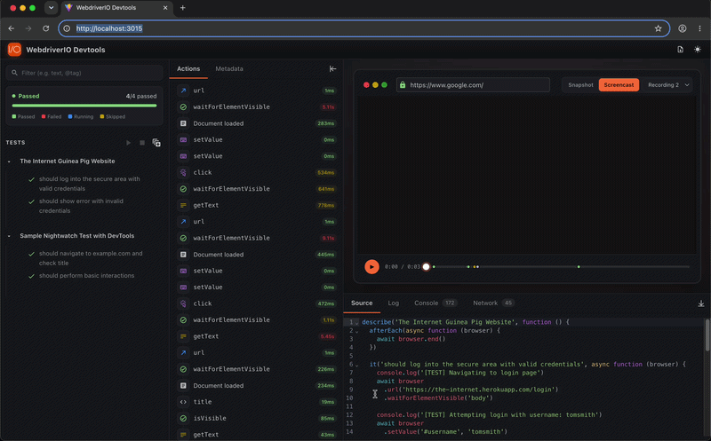

## Installation

**WebdriverIO:**
```bash
npm install @wdio/devtools-service
```

**Nightwatch:**
```bash
npm install @wdio/nightwatch-devtools
```

**Selenium:**
```bash
npm install @wdio/selenium-devtools
```

**Python (Selenium):**
```bash
pip install selenium-devtools-py              # or, from this repo: pip install -e packages/selenium-devtools-py
selenium-devtools install-backend              # once — pip cannot install a Node package
```

The Python adapter needs Python 3.10+, selenium 4.44+, and **Node.js 22.23.4+, 24.22.1+ or 26.12.1+ on your
PATH** — the backend that serves the page collector, carries the event stream
and builds the trace archive is a Node app, so Node is required in every mode,
not just for the dashboard window. Without the install step a run fetches that
backend with `npx` on first use, which works but costs a registry round trip
every run.

> See the [Nightwatch Integration](#nightwatch-integration), [Selenium Integration](#selenium-integration) and [Python Integration](#python-integration) sections for configuration details.

## Configuration

**Live mode** (default) — opens the dashboard:

```javascript
// wdio.conf.js
export const config = {
  services: ['devtools']
}
```

**Trace mode** — writes a portable `trace.zip` under `test-results/`, no UI window:

```javascript
export const config = {
  services: [['devtools', { mode: 'trace' }]]
}
```

Common options (all optional):

| Option | Values | Default | Notes |
|---|---|---|---|
| `mode` | `'live'` \| `'trace'` | `'live'` | Dashboard vs. portable artifact |
| `traceFormat` | `'zip'` \| `'ndjson-directory'` | `'zip'` | Trace mode only |
| `traceGranularity` | `'session'` \| `'spec'` \| `'test'` | `'session'` | One trace per session / spec / test |
| `tracePolicy` | `'on'` \| `'retain-on-failure'` \| … | `'on'` | Which traces to keep (trace mode) |
| `filmstrip` | `boolean` | `true` | Dense screencast into the trace |
| `screenshot` | `'off'` \| `'on'` \| `'only-on-failure'` | `'off'` | Per-test; needs `traceGranularity: 'test'` |
| `video` | `'off'` \| `<tracePolicy>` | `'off'` | Per-test; needs `traceGranularity: 'test'` |
| `captureAssertions` | `boolean` | `true` | Capture assertions as action rows |

**Full option reference:** [`@wdio/devtools-service` README](./packages/service/README.md#reference) — plus the [Nightwatch](./packages/nightwatch-devtools/README.md#reference) and [Selenium](./packages/selenium-devtools/README.md#reference) references.

## Usage

### Live mode

1. Run your WebdriverIO tests
2. The devtools UI automatically opens in an external browser window
3. Tests begin executing immediately with real-time visualization
4. View live browser preview, test progress, and command execution
5. After the initial run, use the play buttons to rerun individual tests or suites
6. Click stop anytime to terminate running tests
7. Explore actions, metadata, console logs, and source in the workbench tabs

### Trace mode

With `mode: 'trace'` no UI opens — the run writes a portable `trace.zip` under `test-results/`. Open it in the first-party player (the `show-trace` bin ships with each adapter):

```bash
pnpm show-trace test-results/trace-<sessionId>.zip
# or from a project that installs an adapter:
npx show-trace <path-to-trace.zip>
```

<p align="center">
  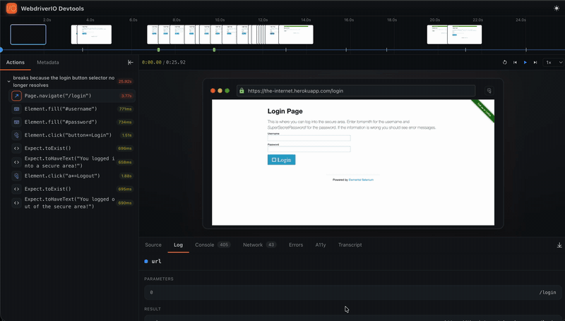
</p>

See the [Trace mode](./packages/service/README.md#trace-mode) section for the full artifact contents and player features.

## Development

```bash
pnpm install          # install workspace dependencies
pnpm build            # build all packages
pnpm test             # run the vitest suite
pnpm test:coverage    # run with coverage (thresholds enforced in CI)
pnpm lint             # lint all packages

# Run an example project for manual UI / runtime verification:
pnpm demo:wdio        # or: pnpm demo:nightwatch / pnpm demo:selenium

# Mobile (Appium). Drives the Clock app that ships with every Android system
# image, so there is no .apk to supply. Needs Appium and an Android device or emulator — see
# examples/MOBILE.md.
pnpm demo:wdio:mobile             # or :selenium:mobile / :nightwatch:mobile / :python:mobile
DEVTOOLS_MODE=trace pnpm demo:wdio:mobile   # trace instead of live
DEVTOOLS_MOBILE_PLATFORM=ios pnpm demo:wdio:mobile   # iOS simulator (any adapter)
```

See **[CONTRIBUTING.md](./CONTRIBUTING.md)** for the full contributor workflow and **[ARCHITECTURE.md](./ARCHITECTURE.md)** for where each piece lives.

## Nightwatch Integration

Using [Nightwatch.js](https://nightwatchjs.org/)? A dedicated adapter package brings the same DevTools UI to your Nightwatch test suite with zero test code changes.

→ **[`@wdio/nightwatch-devtools`](./packages/nightwatch-devtools/README.md)** — configuration, Cucumber/BDD setup, and limitations.

## Selenium Integration

Using `selenium-webdriver` directly — under Mocha, Jest, Cucumber, or a plain Node script? A runner-agnostic adapter brings the same DevTools UI to any Selenium test suite. The plugin auto-detects the runner and wires test boundaries; no code changes required for hook-aware runners, and a small `DevTools.startTest/endTest` API for plain scripts.

→ **[`@wdio/selenium-devtools`](./packages/selenium-devtools/README.md)** — per-runner setup, configuration options, and screencast details.

## Python Integration

Writing your Selenium tests in Python? A fourth adapter feeds the same backend and UI over the same language-neutral `{scope, data}` contract. Under pytest nothing goes in your test files — the plugin ships with the package and pytest auto-discovers it, so opting in is a flag rather than an import.

**Both modes work.** Live mode streams to the dashboard; trace mode writes the same portable `trace.zip` the JavaScript adapters do, under `test-results/` beside the test file, and opens in the same player:

```bash
pytest --devtools tests/              # live dashboard
pytest --devtools-trace tests/        # trace archive instead, no dashboard window
pnpm show-trace test-results/trace-<sessionId>.zip
```

The player is the `show-trace` bin of the Node backend the adapter already needs, so there is nothing extra to install.

Capture is always opt-in, and there are three ways to say yes — `--devtools` / `--devtools-trace` for one run, `devtools` / `devtools_trace` under `[tool.pytest.ini_options]` for a project, `DEVTOOLS_ENABLE=1` (or `DEVTOOLS_PORT=<n>`, which also attaches to a running backend) for a shell. Highest wins, in that order. A plain script calls `devtools.enable(trace=True)` instead.

A Python trace carries the dense filmstrip, the A11y tree with its element overlay, DOM time-travel, console, network, per-command screenshots and command selectors. The transforms that build the zip stay in the backend rather than being ported ([#298](https://github.com/webdriverio/devtools/issues/298)), so trace mode starts the backend but opens no window.

Two settings shape the output, as flags, ini options, environment variables or `enable()` arguments: `traceGranularity` (`session`, the default, or `test` for one archive per test) and `tracePolicy` (`on`, or `retain-on-failure` to keep only what failed). Together, `test` + `retain-on-failure` writes one archive per failing test and nothing for a green run. The four retry-aware policies are accepted but behave exactly like `retain-on-failure` — nothing on the wire carries an attempt number. Per-test `screenshot`, `video` and inline Allure attach remain Node.js-only; it is the trace archive that is per-test.

→ **[`selenium-devtools-py`](./packages/selenium-devtools-py/README.md)** — pytest and plain-script setup, trace mode, assertions, run controls, Preserve & Rerun, and parallel runs.

## Project Structure

```
packages/
├── shared/                # Types, constants, HTTP/WS contracts — single source of truth
├── core/                  # Framework-agnostic capture/reporting library (SessionCapturerBase, etc.)
├── app/                   # Frontend Lit-based UI application
├── backend/               # Fastify server, WS gateway, baseline store, rerun spawner
├── script/                # Browser-injected trace collection script (runs in the page under test)
├── elements/              # Element-detection scripts — getSnapshot, a11y tree, element list (@wdio/elements)
├── service/               # WebdriverIO adapter (@wdio/devtools-service)
├── nightwatch-devtools/   # Nightwatch adapter (@wdio/nightwatch-devtools)
├── selenium-devtools/     # Selenium WebDriver adapter (@wdio/selenium-devtools)
└── selenium-devtools-py/  # Python Selenium adapter (selenium-devtools-py) — live + trace
```

`shared` and `core` are workspace-internal (`"private": true`) — every consumer bundles them into its own `dist/` at build time. The three JavaScript adapter packages each translate framework-specific hooks into calls on `core`'s shared capture library; the Python adapter speaks the same wire contract without sharing that code, which is what [#278](https://github.com/webdriverio/devtools/issues/278) exists to address; `backend` and `app` import only from `shared` and communicate via the WS/HTTP boundary.

## Contributing

Contributions are welcome! Start here:

- **[CONTRIBUTING.md](./CONTRIBUTING.md)** — dev setup, running tests & lint, changesets, and the pre-push / PR checklist.
- **[ARCHITECTURE.md](./ARCHITECTURE.md)** — the package map and the "where does my change go?" decision tree.
- **[CLAUDE.md](./CLAUDE.md)** — the repo conventions (single source of truth, thin adapters, testing floor, commit style).

Rule of thumb: **one concern per PR**, and any change that would otherwise land in two or more adapters belongs in `core`.

## :page_facing_up: License

[MIT](/LICENSE)
